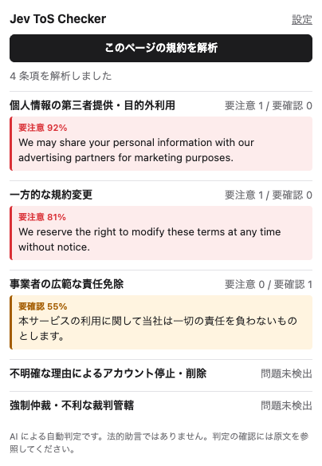
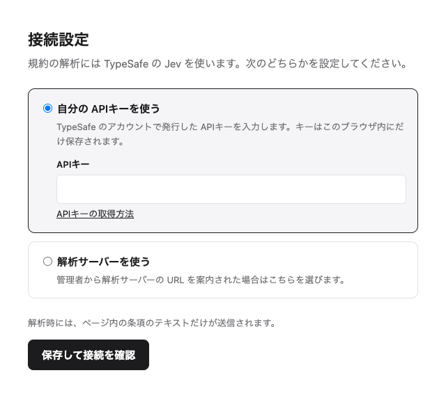

# Jev ToS Checker

[English](README.md) | 日本語 | [Web サイト](https://shohei81.github.io/jev-tos-checker/ja/)

閲覧中のページの利用規約を読み取り、あなたにとって不利になりうる条項を TypeSafe の [Jev](https://docs.typesafe.ai) モデルで見つけて示す Chrome 拡張機能です。

<p>
  
</p>

## About

利用規約は長く、大事な条項ほど見落としがちです。Jev ToS Checker は規約のページを条項ごとに分け、5種類のリスクについて1つずつ判定します。該当した条項は原文と一緒に表示するので、最終的な判断はご自身で行えます。

- **どのサイトでも使える**: 開いているページをその場で解析します。事前に評価済みのサービスに限られません。
- **根拠を示す**: 結果を押すと、ページ内の該当する条項までスクロールして枠で示します。
- **言語を問わない**: 画面はブラウザの言語に合わせて日本語か英語で表示します。解析する規約はどの言語でもかまいません。
- **頼んだときだけ読む**: ページを読み取るのはボタンを押したときだけで、送信するのは条項のテキストだけです。

このツールは、確認すべき条項を見つけるための補助です。サービスが「安全」かどうかを判定するものではなく、法的助言でもありません。

### 判定する内容

| カテゴリ | 見つけるもの |
| --- | --- |
| 個人情報 | データの第三者提供や目的外利用 |
| 規約変更 | 事前の通知なく規約を変更できる条項 |
| 責任制限 | 事業者の責任を広く免除・制限する条項 |
| アカウント | 明確な理由なくアカウントを停止・削除できる条項 |
| 紛争解決 | 強制仲裁、集団訴訟の放棄、利用者に不利な裁判管轄 |

各条項にカテゴリごとの 0〜1 のスコアが付きます。0.7 以上を **要注意**、0.3 以上 0.7 未満を **要確認** として表示します。

## インストール

まだ Chrome ウェブストアには公開していないため、ダウンロードしたフォルダから読み込みます。2分ほどで終わります。

1. [jev-tos-checker.zip](https://github.com/shohei81/jev-tos-checker/releases/latest/download/jev-tos-checker.zip) を**ダウンロード**します([Releases](https://github.com/shohei81/jev-tos-checker/releases) ページにある最新版です)。
2. **zip を展開**すると `jev-tos-checker` フォルダができます。書類フォルダなど、残しておく場所に移してください。あとでフォルダを削除・移動すると拡張機能が動かなくなります。
3. Chrome のアドレスバーに `chrome://extensions` と入力して Enter を押します。
4. 右上の **デベロッパー モード** をオンにします。
5. **パッケージ化されていない拡張機能を読み込む** を押し、手順 2 の `jev-tos-checker` フォルダを選びます。
6. ツールバーのパズルのアイコンから **Jev ToS Checker** をピン留めしておくと、すぐに使えます。

### ダウンロードしたファイルの確認(任意)

リリースのファイルはこのリポジトリの GitHub Actions で作られ、GitHub がビルドごとに署名付きの記録を残しています。[GitHub CLI](https://cli.github.com) を使っている場合は、zip がこのリポジトリで作られ、改ざんされていないことを確認できます。

```sh
gh attestation verify jev-tos-checker.zip --repo shohei81/jev-tos-checker
```

v0.3.0 より後に公開したリリースが対象です。

### 接続の設定

インストールすると設定画面が自動で開きます。どちらかを選んで **保存して接続を確認** を押してください。

- **自分の APIキーを使う**: TypeSafe のアカウントで発行した APIキーを貼り付けます([取得方法](https://docs.typesafe.ai/introduction/quickstart))。キーはこのブラウザ内にだけ保存されます。
- **解析サーバーを使う**: 解析サーバーを用意してくれた人がいる場合は、案内された URL を入力します。

<p>
  
</p>

あとから設定を変えるときは、拡張機能を開いて右上の歯車のアイコンを押します。

## 使い方

1. 利用規約やプライバシーポリシーのページを開きます。
2. 拡張機能のアイコンを押し、**このページの規約を解析** を押します。
3. 結果はカテゴリごとにまとめて表示されます。条項を押すと、ページ内のその箇所に移動します。

## 開発者向け

```
core/       Jev への問い合わせとカテゴリ定義(拡張機能とサーバーで共有)
extension/  Chrome 拡張 (Manifest V3)
worker/     解析サーバー (Cloudflare Worker)。APIキーを配らずに拡張機能を提供したい場合に使う
```

```sh
npm install
npm run build      # extension/dist を生成。extension/ をパッケージ化されていない拡張機能として読み込む
npm run package    # jev-tos-checker.zip を生成
npm test
npm run typecheck
```

- Jev への質問文は `core/categories.ts`、しきい値は `extension/src/classify.ts` にあります。
- 画面の文言は `extension/_locales/{en,ja}/messages.json` にあります。言語を追加するときは同じキーを持つファイルを追加します。
- `v*` のタグを push すると `.github/workflows/release.yml` が zip を作り、GitHub のリリースに添付します。

### 解析サーバーの起動

```sh
npm install-scripts approve workerd   # wrangler dev に必要
echo 'TYPESAFE_API_KEY=<your key>' > .dev.vars
npm run dev:worker                    # http://localhost:8787

npx wrangler secret put TYPESAFE_API_KEY
npm run deploy:worker
```

サーバーにはまだアクセス制限がありません。URL を知っていれば誰でも使え、その利用料はあなたの APIキーに請求されます。

## ライセンス

[MIT](LICENSE)
