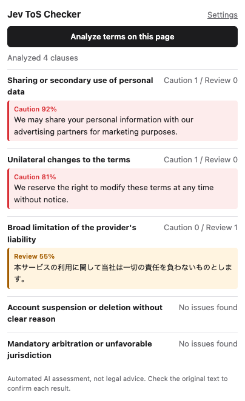
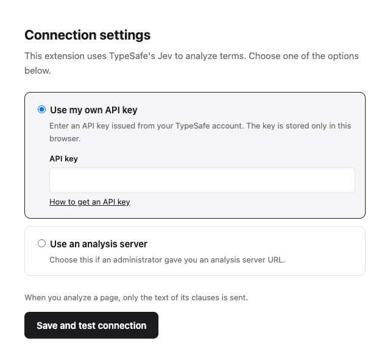

# Jev ToS Checker

English | [日本語](README.ja.md)

A Chrome extension that reads the terms of service on the page you are viewing and points out clauses that may work against you, using TypeSafe's [Jev](https://docs.typesafe.ai) model.

<p>
  
</p>

## About

Terms of service are long, and the clauses that matter most are easy to miss. Jev ToS Checker splits a terms page into clauses and checks each one for five kinds of risk. It shows every match next to the original text, so you can judge it yourself.

- **Works on any site.** It analyzes the page in front of you on the spot, so it does not depend on a database of pre-reviewed services.
- **Shows its evidence.** Click a result to scroll to that clause on the page and highlight it.
- **Works in any language.** The extension's interface is in English or Japanese, following your browser. The terms you analyze can be in any language.
- **Reads the page only when you ask.** The extension reads the page only when you click its button, and sends only the text of the clauses.

This tool helps you find clauses worth a closer look. It does not decide whether a service is "safe", and it is not legal advice.

### What it checks

| Category | What it looks for |
| --- | --- |
| Personal data | Sharing your data with third parties or using it for other purposes |
| Changes to the terms | Changing the terms without notifying you in advance |
| Liability | The provider broadly excluding or limiting its liability |
| Accounts | Suspending or deleting accounts without clear reasons |
| Disputes | Mandatory arbitration, class action waivers, or venues that are unfavorable to you |

Each clause gets a score from 0 to 1 per category. A score of 0.7 or higher is shown as **Caution**, and from 0.3 up to 0.7 as **Review**.

## Installation

The extension is not on the Chrome Web Store yet, so you install it from a downloaded folder. It takes about two minutes.

1. **Download** [jev-tos-checker.zip](https://github.com/shohei81/jev-tos-checker/releases/latest/download/jev-tos-checker.zip) (the latest version from the [Releases](https://github.com/shohei81/jev-tos-checker/releases) page).
2. **Unzip it.** You get a folder named `jev-tos-checker`. Move it somewhere you will keep it, such as your Documents folder. If you delete or move the folder later, the extension stops working.
3. In Chrome, type `chrome://extensions` in the address bar and press Enter.
4. Turn on **Developer mode** in the top-right corner.
5. Click **Load unpacked** and select the `jev-tos-checker` folder from step 2.
6. To keep the extension handy, click the puzzle-piece icon in the toolbar and pin **Jev ToS Checker**.

### Set up a connection

After installation, the settings page opens automatically. Choose one option and click **Save and test connection**.

- **Use my own API key**: paste an API key from your TypeSafe account ([how to get one](https://docs.typesafe.ai/introduction/quickstart)). The key is stored only in your browser.
- **Use an analysis server**: if someone runs a server for you, enter the URL they gave you.

<p>
  
</p>

To change these settings later, open the extension and click **Settings** in the top-right corner.

## Usage

1. Open a terms of service or privacy policy page.
2. Click the extension icon, then **Analyze terms on this page**.
3. Results are grouped by category. Click a clause to jump to it on the page.

## For developers

```
core/       Jev requests and category definitions (shared by the extension and the server)
extension/  Chrome extension (Manifest V3)
worker/     Analysis server (Cloudflare Worker), for offering the extension without handing out an API key
```

```sh
npm install
npm run build      # build extension/dist; load extension/ as an unpacked extension
npm run package    # create jev-tos-checker.zip
npm test
npm run typecheck
```

- The questions sent to Jev are in `core/categories.ts`, and the thresholds are in `extension/src/classify.ts`.
- The UI text is in `extension/_locales/{en,ja}/messages.json`. To add a language, add a file with the same keys.
- Pushing a `v*` tag runs `.github/workflows/release.yml`, which builds the zip and attaches it to a GitHub release.

### Running the analysis server

```sh
npm install-scripts approve workerd   # required by wrangler dev
echo 'TYPESAFE_API_KEY=<your key>' > .dev.vars
npm run dev:worker                    # http://localhost:8787

npx wrangler secret put TYPESAFE_API_KEY
npm run deploy:worker
```

The server has no access control yet. Anyone with the URL can use it, and their requests are billed to your API key.

## License

[MIT](LICENSE)
